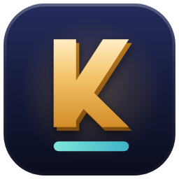

# Kinah Ledger

A fan project for Aion 2 (global): Kinah per hour, material yields, drop rates and market prices,
built from runs players share through a free tracker. Made by players for players; not affiliated
with NCSOFT. MIT licensed.

This is a side project, separate from the author's professional work.

## Download

[**KinahLedger-Setup.exe, the latest installer**](https://github.com/StevenMacchia/kinah-ledger/releases/latest/download/KinahLedger-Setup.exe):
Windows 10 or 11, installs for your Windows user only (no administrator rights), with Start menu and desktop shortcuts
and small automatic updates. The single-file `KinahLedger.exe` is on the
[releases page](https://github.com/StevenMacchia/kinah-ledger/releases/latest) too, with no installer. Every release
lists both files' SHA-256 checksums.

Releases are signed with Microsoft Artifact Signing once it is set up; until then Windows SmartScreen asks once
(More info › Run anyway). What is signed, who can sign, and what the tracker sends:
[CODE_SIGNING_POLICY.md](CODE_SIGNING_POLICY.md).

```
(website)  lives in a separate private repo; kinahledger.com/download serves this repo's releases
tracker/   the Windows tracker, C# / .NET 8
tools/     data tooling (item dictionary crawler, site data build)
data/      data drops (tw-items.json goes here)
docs/      notes on data sources and the pipeline
```

## Tracker status

The tracker only ever reads the screen. It never captures network traffic, reads game memory, modifies
the client or sends input to the game; everything runs on the player's PC, and what leaves it is listed
below. (An earlier packet-capture experiment was removed in 0.6.0 so that this stays true in full.)

Since 0.6.2 it reads only the parts of the game that nothing covers. While another window sits over the chat
(a browser, a chat app, the tracker's own window) or the game is minimized, reading pauses, the window says
which program is in the way, and that time doesn't count toward any per-hour rate. `KinahLedger.exe in-view`
shows what the tracker can see right now. Since 0.6.4 a zone name it has never seen (not in its list and without
a place word such as Valley or Ruins) has to be read twice in a row before it counts, so a button or tooltip that
drifts over the minimap can't become a zone. Since 0.6.5 such a name is shown in the window only: what is shared files
that time under "Unknown zone", so the site's spot tables hold only zones the tracker is sure of.

**Screen reading.** The game prints every pickup in chat ("Acquired 2,790 Kina.",
"Acquired Drakan hide ×2."). The tracker reads those lines off the screen with the text recognition
built into Windows, counts what's new whenever the game is open, and times farming runs on top of that
count with Kinah and loot per hour in the panel, a small always-on-top strip over the game. Setup is picking your server once.

1. Play in borderless or windowed mode with the chat open at the bottom-left. A chat tab showing only System Notifications reads best; the normal tab works too, and so does the frameless chat with no input box.
2. Double-click `KinahLedger.exe`. On first run pick your region, faction and server, and a look (Night, Abyss or Daylight); everything shared is filed per server. From then on the tracker finds the game window, the chat (above the "Enter your message" box, or from its own lines) and the zone on the minimap by itself, and **counts everything the chat shows while the game is open**: drops, gathers, Soul Crystals, and Market prices whenever the Market is open. That count is shared anonymously in 15-minute chunks and never kept here.
3. **Start run** times a run on top of that count, and Stop saves it to your history and shares it. Open world or gathering is read from the chat, so there is nothing to pick: the run is saved and shared under what it turned out to be. The window opens on the session total and the three best drops; each table appears and opens once something lands in it. **Copy for Discord** puts a picture of the count (zone, per hour, top drops) on the clipboard, and the run card says your best hour in the zone once a stay of ten minutes or more has set one. Farming time is noticed from the chat itself: every loot, kill or gather line keeps the farming clock running, a minute with none stops it until the next, so every per-hour rate (here and on the site) divides by time actually spent farming, while counts and drop rates keep counting regardless. Open world shows Kinah per hour and per kill, kills per hour, drops per hour, and every drop with its drop rate and per-hour rate, with item names in the game's tier colours. Gathering splits each skill (mining, logging, essence extraction, herbs, cooking ingredients) into its own section with its own attempts, Plentiful rate and per-attempt rates. Pets counts Soul Crystals by zone with drops and per hour only, no drop %, so the best pet-farming spot stands out. Soul Points and Soul Crystals never count as drops. The game's item list is built into the tracker and is the whitelist for drops: a name that isn't on it (a misread, a nameplate behind the chat) is never counted and never sent. Zones work the same way against the tracker's zone list; anything else counts under "Unknown zone". Ctrl+Shift+K starts and stops a run from inside the game; minimizing keeps everything running in the tray.

   **Zones.** The tables start over when you change zone, so they show the zone you are in. Tick **All zones** under the activity picker to keep them counting across zones. Either way, what goes to the site is split by zone: each zone sends its own time, Kinah, kills and items, so one zone's drops are never filed under another.

   **Loot.** Under the run card, **Loot** shows what was picked up as inventory slots, one period at a time: **This zone**
   (the run while one is on, every zone with All zones on) or **Today**, since midnight on this PC, with the zones you
   farmed a minute or more to pin one. One total sits on its line. Hover a slot for its odds, how many come an hour and
   what it is worth; click it for its full card, right-click it to report it. Time reads one way everywhere: 5 min,
   1 h 12 min. Lines that only matter when something is wrong (how reading is going, reward lines left out, the last
   line read) wait in the ⋯ menu until they do.

   **Compact and Full view.** The button beside Options switches between one column (the run card and Loot) and Full
   view, the drop tables beside them. On a screen narrower than Full view (a 1080p screen at 150% scaling, say) both columns are drawn smaller
   to fit, down to 75%; on a narrower one still the window shows Compact and says so.

   **Undo.** Clear the tables (the … menu), Clear on Events, Start over on Crafting, Remove on a run and Stop run in the
   window happen at once, with an Undo bar at the bottom of the window for eight seconds (Ctrl+Z works too). They become
   final when the bar goes: only then is what was counted shared and started over, a run removed or a stopped run saved.

   **Quest rewards** are left out of every farming number. Kinah marked (Bound), the Kinah after a "total payment … completed" line, a Kinah line that names a quest or reward, and any single Kinah line far above what the mobs pay (more than 25 times the median of your last pickups) are counted as skipped rewards, shown in the summary line, never as income or kills.

   **Kinah by enemy (a best guess).** The tracker reads the target bar at the top-centre of the game every 2 seconds. Kinah, drops and Soul Crystals that land within 8 seconds of it naming an enemy are credited to that enemy, in the zone you fought it in. With several enemies on you the bar shows only one of them, so these figures are a guess, and the window and the site say so. Only enemy names on the tracker's enemy list (`data/mobs.txt`) count. If the panel sits on the target bar, the window asks you to drag it aside.

   **Reading names right.** A name read with a letter or two wrong is settled by more than its letters. The tracker learns
   the colour each item grade is printed in from names it reads exactly (kept in `grade-colours.json` beside the logs), so a
   garbled name in gold can only be a gold-grade item. Of two items as close to what was read, the one on this run or on the
   loot table of the enemy you are fighting (the target bar and the nameplates around you) wins. A name guessed from a cut-off
   line that none of those enemies' tables lists isn't counted from the chat; the loot list beside your character counts it
   if it showed it. That loot list's rows are also named by the icon beside them when their text is cut off or garbled and
   one icon is clearly the one shown. The chat is enlarged before it is read by how tall its text is on your screen (never
   less than 2x), so a 1080p screen reads as well as a 4K one. Each can be turned off in `settings.json` (`ocr.nameColours`,
   `ocr.lootIcons`, `ocr.autoScale`, with `ocr.targetTextPx` for the text size aimed at), and `reads.log` says each time one
   of them changed what was counted.

   **Report a miscount.** The tracker keeps the last minute of what it read (chat and loot list, as text) and what it
   counted. **Report a miscount** at the bottom of the window, **Report** on a drop (hover its row: "Looks wrong? Report"), or a
   wrong line in the feed (click it) saves that minute to a folder
   under `reports` beside the logs, with the tracker's state and the end of `reads.log`, and opens it for attaching to a bug
   report. Pictures of the chat and the loot list are kept too only when you say yes (asked the first time, and in
   Options › Sharing), since they can show other players' names and messages. Nothing is sent anywhere.
   `KinahLedger replay <report>/trace.jsonl` counts the text again, and `KinahLedger report-replay <report>` reads the
   pictures again with the current reader, beside what was counted at the time.

   **Crafting** is its own part of the window: it shows by itself while the crafting window is open, or press **Crafting** at the top. Each recipe shows how many times you tried it, how often it worked, what came out (a great success included), what one try costs and what the result sells for, with the profit or loss. Costs come from the recipe's materials at the lowest Market prices on your server; a failed try uses them too. Bound vendor materials can't be priced and are left out, and the row says so. The recipes come from [MetaBot.GG](https://metabot.gg/en/aion-2/crafting). Crafted items are never drops, crafting is never farming time, and none of it goes into a zone's numbers. Market settlement payouts ("A total payment of … completed") are never farming Kinah either.
4. **Options** (its own window, with **Save** and **Cancel**) holds everything that can be set, page by page:
   - **General**: start with Windows (it then waits in the tray until Aion 2 is running), what happens when Aion 2
     starts (open the window, or stay in the tray; reading starts either way), hide when Aion 2 closes, the close
     button keeping it in the tray, minimize to the tray, switching pages to what you're doing (on by default: the
     window shows Farming, Crafting or Events once a change has held 5 seconds, and a page you click stays until you
     start something else; the window always opens on Farming), and the look.
   - **Server**: region and server; everything shared is filed under it.
   - **Sharing**: the one **Share** switch (runs and Market prices together), linking this PC to your profile on the
     site (the link code is a short form of the random install ID; without it runs stay anonymous), replacing the
     install ID, and the data folder.
   - **Game reading**: **Detect now**, **Choose the chat**, **Test read**, the Market area, and a live preview of what
     is read. These act right away.
   - **In game**: the start/stop shortcut (Ctrl+Shift+K by default, or off; a letter or number needs Shift with Ctrl or
     Alt, and keys Windows or typing needs, such as Ctrl+C, Alt+Tab or Win combinations, are refused; a shortcut another
     app holds is said in the status line, in a tray notice and on the panel) and the panel, the small strip over the
     game that shows whenever the chat is being read, run or no run. The panel shows only while the game (or the tracker's own
     window) is in front, fades out on alt-tab and comes back with the game, hides when the game is minimized or
     closed, and dims while reading is paused because something covers the chat. It needs borderless or windowed
     mode; Windows can't draw over exclusive fullscreen. **Lock the panel in place** (on for new installs) lets clicks
     go through it to the game and keeps it from ever taking focus; **Move the panel** in the tray menu unlocks it for
     20 seconds, or turn the lock off to drag it with a dashed outline. Its opacity (the background only, so the
     figures stay readable) and size (70 to 200%) apply as you slide them and are kept on Save. It starts at the top
     centre of the game's screen, and a remembered spot is kept on a screen that is still there. The dot beside the
     timer is red only during a run, when the timer reads "RUN 12:31"; the shortcut flashes "Run started" or "Run
     stopped · 1.2M this run" for three seconds. For the first two minutes (and three things counted) the hour's
     figure says it is warming up rather than showing a wild number. An update never asks while the game is in
     front: the panel says it is ready and the question waits until you leave the game. **Panel look** picks how it
     looks, and Options draws all three at their real size with sample figures: the **Strip** (one line with the
     figures you pick, as before, and still the default), the **Card** (a game-tooltip card: the run, the zone, the hour
     in gold, the session, and your last three pickups as item tiles, the newest lit for a few seconds) or the
     **Ticker** (a small pill with the run, the hour and the session, and each pickup sliding in under it as a toast that
     fades after 6 seconds, four at most). The Card and the Ticker say why reading is paused in an orange line instead of
     dimming, and a rare drop lights them in its grade's colour for five seconds. The Ticker starts left of the target
     bar, so its toasts never cover the target's name, and keeps a spot of its own.
   - **Updates** and **About**.

   Only one Kinah Ledger runs at a time: starting it again brings up the running one's window.

The same steps exist as commands for scripting (`pick`, `ocr-test`, `watch`), listed below.

Limits: it only sees what the chat shows, it can miss a line if many arrive in the same instant, and
the first read counts nothing so old lines on screen aren't mistaken for new loot.

**Market prices (0.6.0).** Whenever the tracker window and the game are open, the tracker watches for the game's
Market window; no farming run is needed. When the Market is open, the listings on your screen (item and lowest sale
price on the main board; item, quantity and unit price on a listing table) are read about once a second, the same way the chat is, and queued as anonymous asks so
the site can show per-server prices the way Universalis does for FFXIV. Coverage follows what players look at:
nothing is clicked or typed in the game, and no account ever reads the Market on its own.

- The Market is found by its title and the column headers: the main board's ("Grade", "Item", "Sales List",
  "Lowest Sale Price", where the "Item Level N" line under each name is folded into its row) or a listing table's
  ("Item", "Quantity", "Unit Price", "Total Price"); the headers also give the column positions, so each cell is read on its own. If it can't be found,
  **Choose the Market** lets you drag a box around the rows; each row is then read as one line and split by its
  numbers from the right (quantity, unit price, total). Quantity × unit price has to equal the total, so a misread
  digit drops the row instead of sharing a wrong price. Digits use the chat parser's corrections (O for 0, l for 1,
  thousands separators).
- Your server, chosen on first run, travels with the prices as `region-server` (`na_e-siel-elyos`) so they land on
  the right board; without it, asks are read but not sent.
- Market prices follow the one **Share** switch in Options › Sharing: with sharing off the Market is never read, and the rest
  of the tracker works as before. Options › Game reading shows what the reader is doing: waiting for the game,
  watching for the Market, or reading it, with asks read, items, asks shared and when it last read. The same ask
  (item, stack, price) isn't sent twice within 15 minutes; batches go out every 10 seconds or 100 asks, and once
  more when the window closes.
- Seller names are never captured. With a chosen area, anything after the numbers on a row is dropped, never kept.
- The live preview outlines the Market table in mint next to the chat (blue) and the zone (gold).

The main-board layout comes from a real screenshot of the Market; the listing-table layout from the game's known layout. `KinahLedger market-test --image
shot.png` runs it over a screenshot of the Market and prints what it finds, which is how to check it against the real
window (`--region x,y,w,h` reads an area the way a chosen one is read).

### Build

Needs the .NET 8 SDK once (`winget install Microsoft.DotNet.SDK.8`), then:

```
cd tracker/KinahLedger.Tracker
dotnet build -c Release
dotnet publish -c Release
```

`dotnet publish` writes one self-contained `KinahLedger.exe` to `dist/` with the .NET runtime inside, so players
install nothing. It isn't code-signed yet, so Windows SmartScreen shows a warning the first time it runs; a
signing certificate removes that. There are no drivers or other prerequisites.

### Updates

The tracker keeps itself current. Twenty seconds after it opens, and every hour while it stays open, it asks
GitHub for the latest release of this repository (`api.github.com/repos/StevenMacchia/kinah-ledger/releases/latest`;
only the app version goes up, in the User-Agent). A release counts when it is not a draft or prerelease, carries a
`KinahLedger.exe` file, and its notes have a `KinahLedger.exe sha256: <64 hex>` line. When it is newer:

- **Install new versions automatically** (Options › Updates, on by default): it downloads beside the running exe, is checked
  against the release's size and SHA-256, and replaces the exe when the window closes. A banner offers **Restart now** to
  install it at once; during a farming run that asks first, and the run is stopped and saved before the restart.
- Off: the banner says a new version is out and **Update** downloads it on request. Options › Updates › **Check now** looks again.
- Either way (0.8.31), a new version found by these checks asks once in a dialog: **Yes** installs it now and the tracker
  opens again on it, **No** leaves the banner (and, with automatic installs on, it installs when the tracker closes). It
  never asks during a farming run: it waits until the run stops. No is the default button, so a key meant for the game
  can't restart the tracker. It asks once per version each time the tracker starts. Game data is still checked every six hours.
- `"update": { "check": false }` in `settings.json` turns the check off entirely. `"update": { "manifest": "<url>" }` points it
  at a `latest.json` manifest instead (as `tools/release-manifest.js` writes), for a test server or a mirror.

Windows doesn't let a running exe be overwritten but does let it be renamed, so the swap is: running exe →
`KinahLedger.exe.old`, verified download → `KinahLedger.exe` (whatever the file is called, such as
`KinahLedger (1).exe`). The `.old` copy is deleted on the next start. A download that doesn't match the checksum is
thrown away. Settings, history and logs under `%LOCALAPPDATA%\KinahLedger` are untouched. If the exe sits in a folder
it can't write to (Program Files), the banner links to the releases page instead. `KinahLedger.exe update` does the same
from a terminal (`--check` only reports).

### Releasing

Bump `<Version>` in the csproj to X.Y.Z, write `release-notes/vX.Y.Z.md`, commit, then tag and push:

```
git tag vX.Y.Z
git push origin vX.Y.Z
```

Or, once that commit is on main, release without a tag from anywhere, the GitHub phone app included: Actions ›
**Release tracker** › **Run workflow** on `main`. It takes the version from main's csproj, stops if that version is
already released or its notes are missing, tags main's commit `vX.Y.Z`, and starts the release on that tag (the
`release` environment accepts version tags only, so signing still runs only on a tag).

`.github/workflows/release.yml` builds the single exe and the installer (Velopack: `KinahLedger-Setup.exe` plus the
full and delta update packages) on GitHub, signs them with Artifact Signing once it is set up (see
[CODE_SIGNING_POLICY.md](CODE_SIGNING_POLICY.md) and [docs/signing-setup.md](docs/signing-setup.md)), writes
`latest.json` and publishes the release with each file's checksum on its own line, `KinahLedger.exe sha256: <hex>`
first. It refuses to publish a release without the installer and its packages, which installed trackers update from. Running trackers install a release only when the download
matches it, and pick it up within an hour or at their next start. The run stops if the tag and the csproj disagree or
the notes file is missing.

### Commands

```
KinahLedger locate                       find the game, the chat, the zone and the Market; saves an annotated frame
KinahLedger pick                         drag a box around the chat's loot lines (remembered)
KinahLedger ocr-test [--save]            read the box once and show what was recognized
KinahLedger ocr-test --scales            read the chat at each enlarging factor (--image chat.png for a saved one)
KinahLedger popup-test --image shot.png  read the loot list beside the character in a game picture, with each row's icon match
KinahLedger replay [trace.log]           count recorded reads again (a miscount report's trace.jsonl too)
KinahLedger report-replay <folder>       read a miscount report's pictures again with this version's reader
KinahLedger watch --activity "name"      a farming run in the console, Market reader beside it (--server "Siel (Elyos)", --no-market)
KinahLedger market-watch                 only the Market reader, as the window runs it in the background
KinahLedger parse-test                   self-test of the chat-line parser
KinahLedger market-test                  self-test of the Market row parser
KinahLedger market-test --image shot.png find the Market in a screenshot and read its rows
KinahLedger ui-shot captures/ui --demo   render the window to PNG (--pets, --gathering, --market, --compact, --welcome, --skin night|abyss|daylight)
KinahLedger market-shot captures/ui      the window with the Market reader in its tracking state
KinahLedger reset-id                     new random install ID
```

### What a shared run contains

Server (region and world, as chosen in the window, so drops can be kept per server), activity, gear score
bracket, minutes, kills, Kinah (tradeable and bound), item counts by ID, app version, and a random install ID
used only to drop duplicates and spam. Never the character name, account, class, level, chat text or
screenshots. Sharing is on by default and off with one setting; the live readout works either way.

The totals post once, when the run stops, to `https://kinahledger.com/v1/runs` (`upload.endpoint` in
`settings.json`, set by default; blank it and nothing is sent). Runs under 5 minutes or with no loot are
never sent. If the site can't be reached, the run simply stays on this PC: it is still saved to your
history and is not sent later.

### What a shared price contains

A price batch is `{app, server_key, install, asks: [{item, unit_price, qty, seen_at}]}`: the server you chose
(as `region-server`), each ask's item name, stack size, unit price and the time it was seen, the app version and
the install ID. Never seller names, the character or screenshots. Batches post whenever the window and the game
are open, run or no run, to `https://kinahledger.com/v1/prices`, derived from `upload.endpoint`;
`upload.pricesEndpoint` in `settings.json` overrides it. If the site can't be reached, the batch is retried a few
seconds later; whatever is still unsent when the window closes is dropped, and prices are never stored on this PC.

## Data

`tools/crawl-tw.js` reads NCSoft Taiwan's public item dictionary (English names, grades, categories,
icon URLs). NCSoft's EULA restricts automated access to its services, so running it is the owner's
decision. See `docs/` for the pipeline and image-source notes.

Since 0.6.5 the tracker fetches the site's item list (`kinahledger.com/data/items.json`: the id, name, grade and icon
file name of every item in the game's dictionary, about 850 KB) once per start when it has changed, and keeps it under
`%LocalAppData%\KinahLedger\items.json`. That is how drops leave this PC under their real item ids; nothing about the
player goes up in that request. Offline, the saved copy is used, and a name the list doesn't hold is shared as the name.
A `data/tw-items.json` beside the exe (the crawler's output) is used instead when present.

The tracker ships no icons. When a row's item has a known icon (the 46 gathering materials always; anything else
once the item list is on this PC), the file is fetched once from NCSOFT's image server by name, the
way a browser does on their site, and kept under `%LocalAppData%\KinahLedger\icons`; a session touches a few dozen
files at most. `"ui": { "icons": false }` in `settings.json` turns this off, and rows show a lettered tile instead.
