# Parser v2: before and after

These renders show the build of the round-3 pick: Direction 1 "Command" for the page, Direction 2 "Arena" rows for the overlay, and Arena's pace folded into Compare. The proposals are in `docs/ui/parser-v2-proposal/` and `docs/ui/parser-v2-r3/` on the proposal branch. Render with `KinahLedger.exe ui-shot <dir> --parser [state|overlay|motion] [--skin daylight]`; `KL_MOTION_AT=0..1` holds every transition at one frame.

## The page

| Before (0.10.95/96) | After |
|---|---|
| 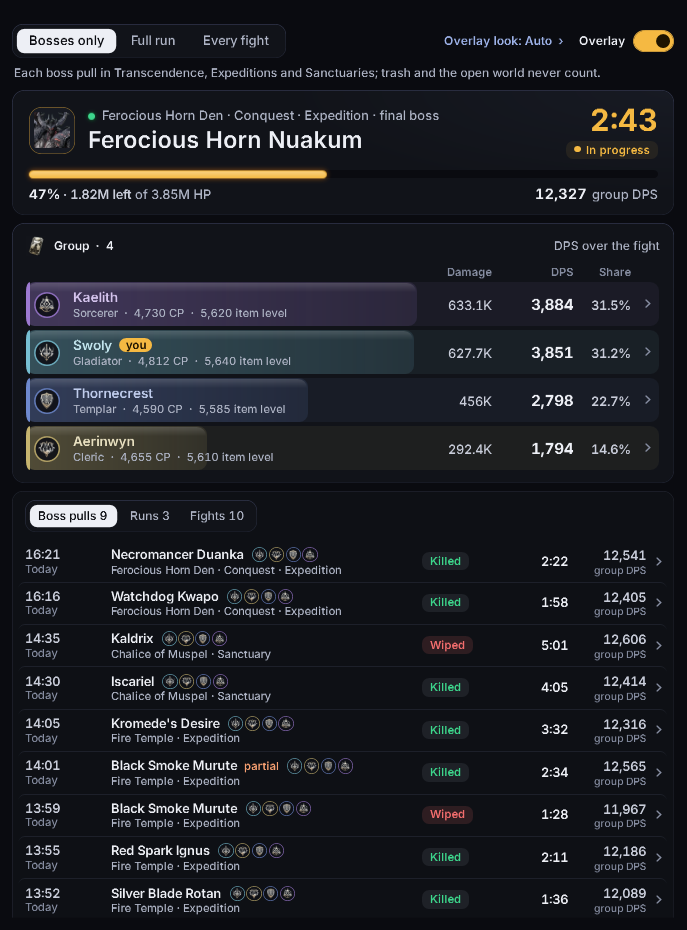 | 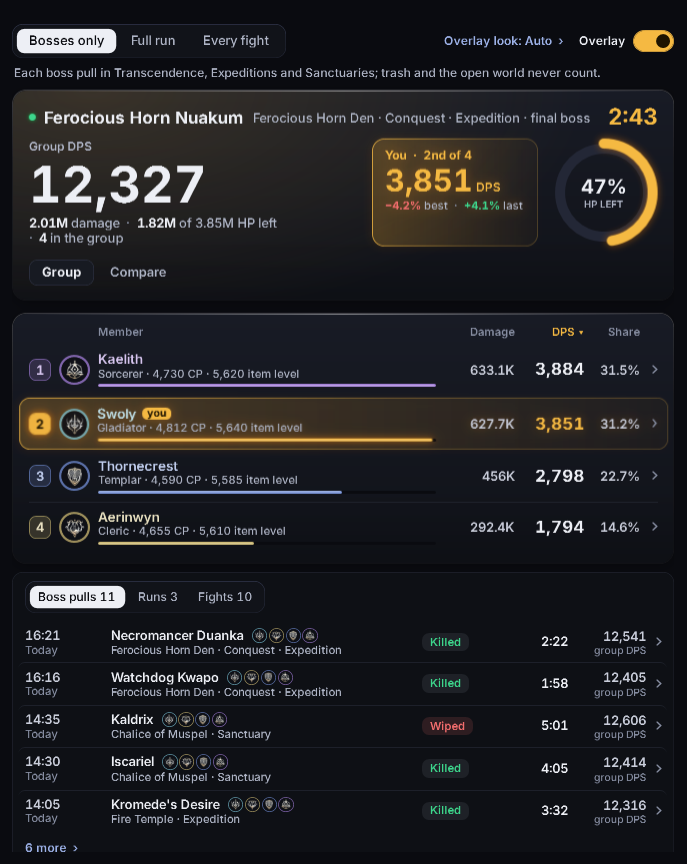 |
| 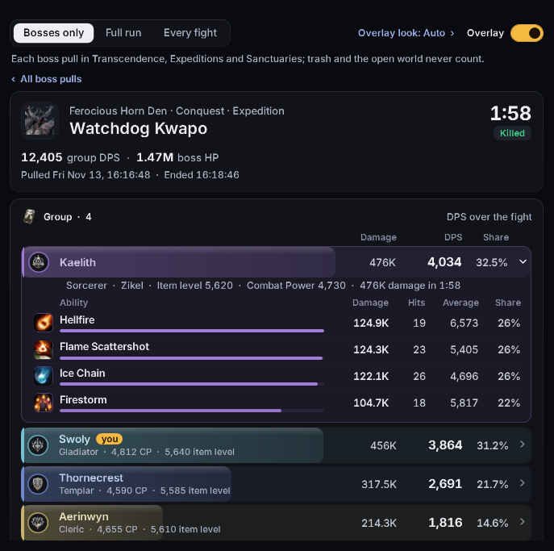 | 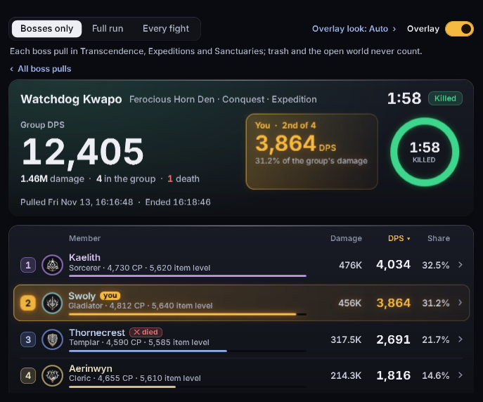 |

The inspect view and Compare (your best kill and last pull of this boss, from the fights kept on this PC):

| Inspect | Compare |
|---|---|
| 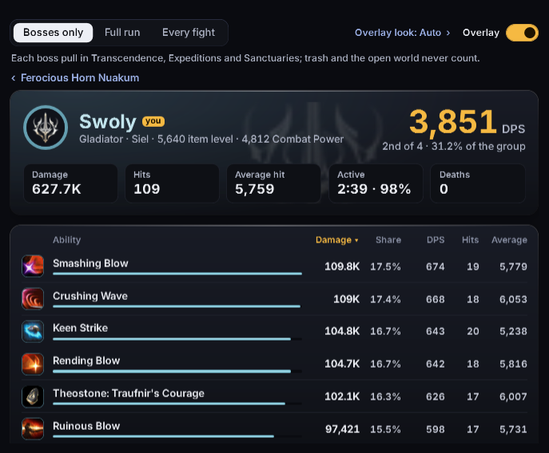 | 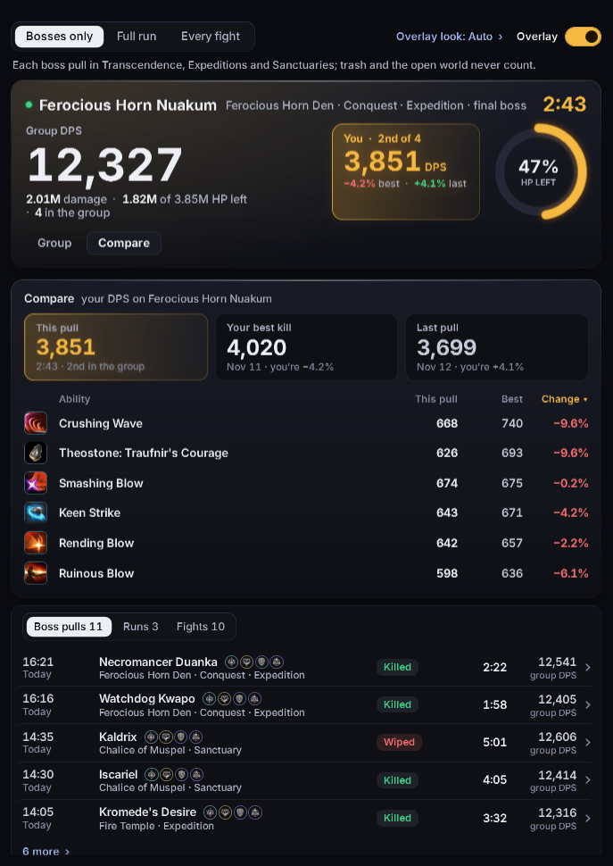 |

Daylight: 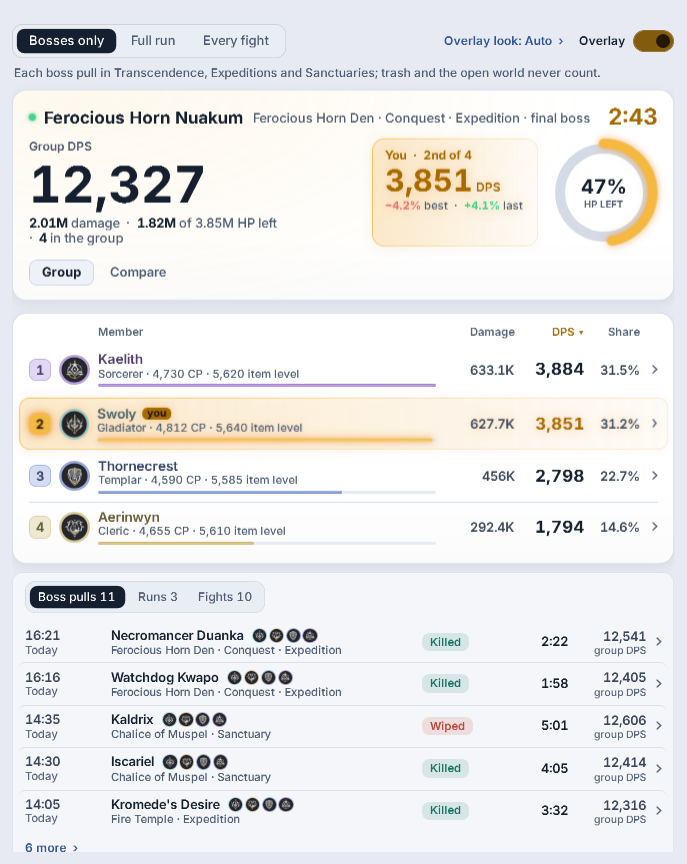 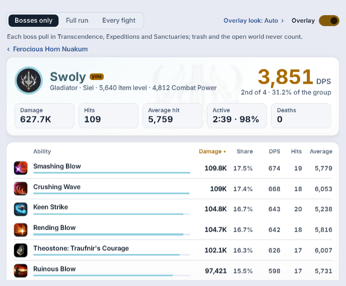

Full run and Every fight: 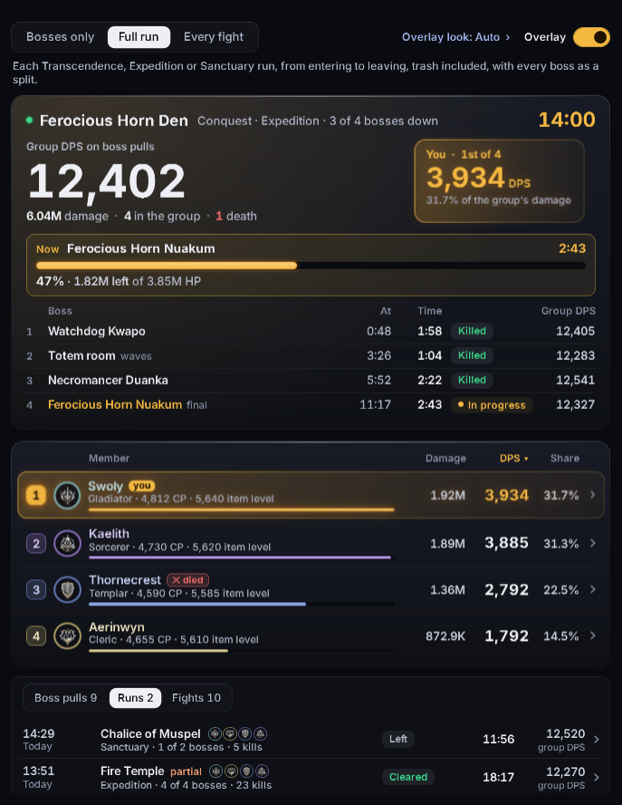 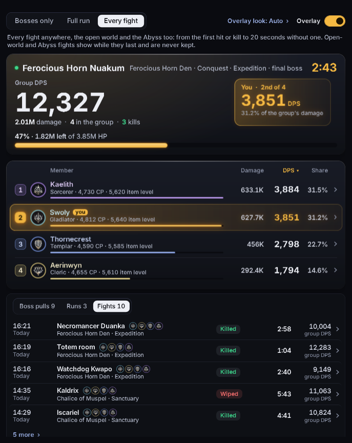

## The overlay, in every look

| Look | Before | After |
|---|---|---|
| Auto (default) | 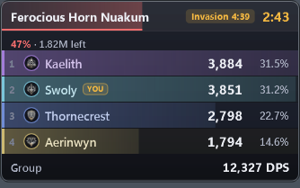 | 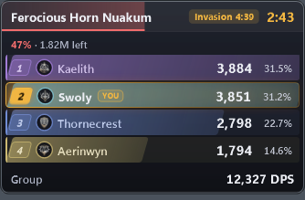 |
| Auto, held | 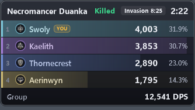 | 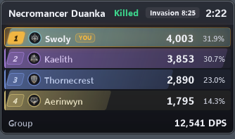 |
| Capsule | 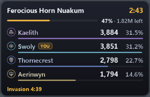 | 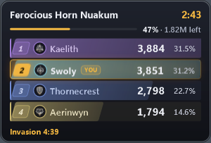 |
| Meter | 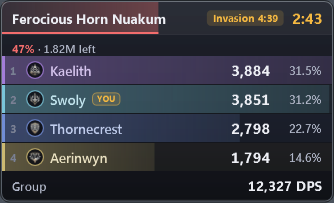 | 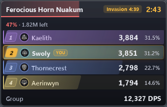 |
| Float | 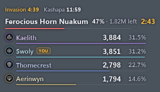 | 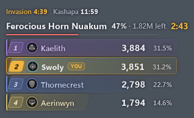 |
| Separate overlay | 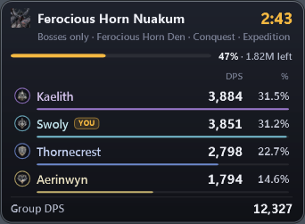 | 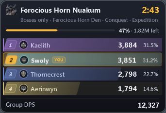 |

Expanded (a click on the meter): 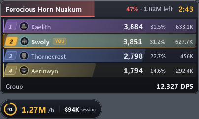. Eight members with you 6th, pinned: 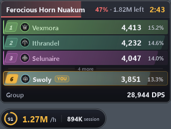 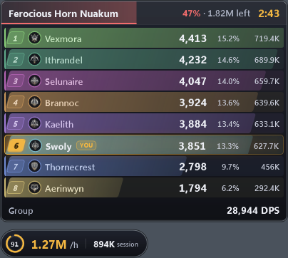

## Motion (held frames)

- Entering a dungeon, the Kinah pill unfolds into the meter: 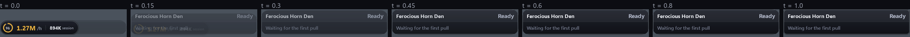
- A member overtakes another: the row glides, the rank chip flips, the figures roll: 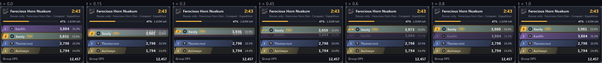
- A death: the coral mark lands on the row: 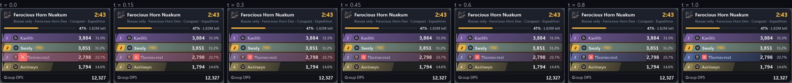
- The kill: a mint sweep: 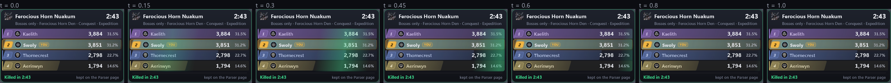
- A new best on this boss: "PB +4.2%" and a gold burst: 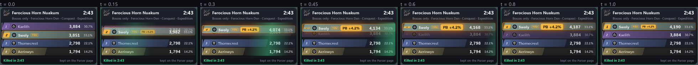
- Runs to Parser: a run's boss pull flies into its view: 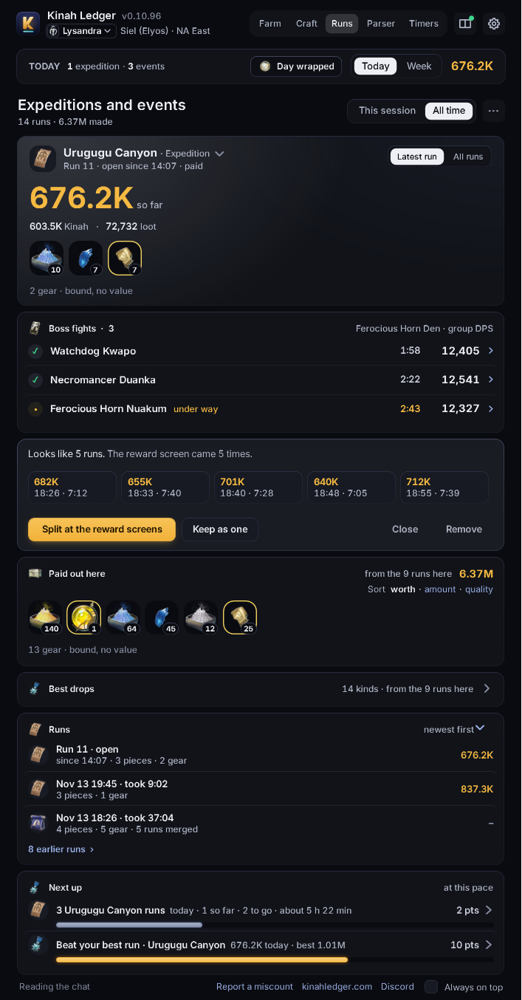 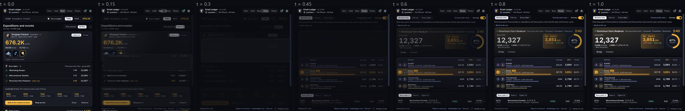

## What the record carries, and what waits for it

| Shown now (real data) | Built, hidden until the record carries it |
|---|---|
| DPS, share, damage, hits, average hit per ability, deaths (a count), active time, members, CP and item level, boss HP, your best and last pull of a boss (from kept fights) | Casts, max and min hit, crit, the per-second timeline and sparklines, damage taken, the death recap (killer and last 5 hits), buff uptime |

The second column, drawn from a render-only sample (`ui-shot --parser full|timeline|taken|inspect-full`): 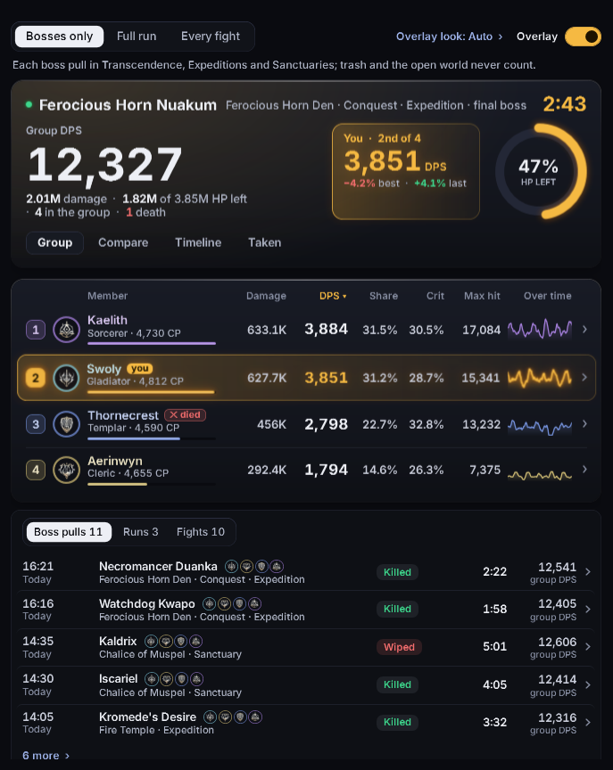 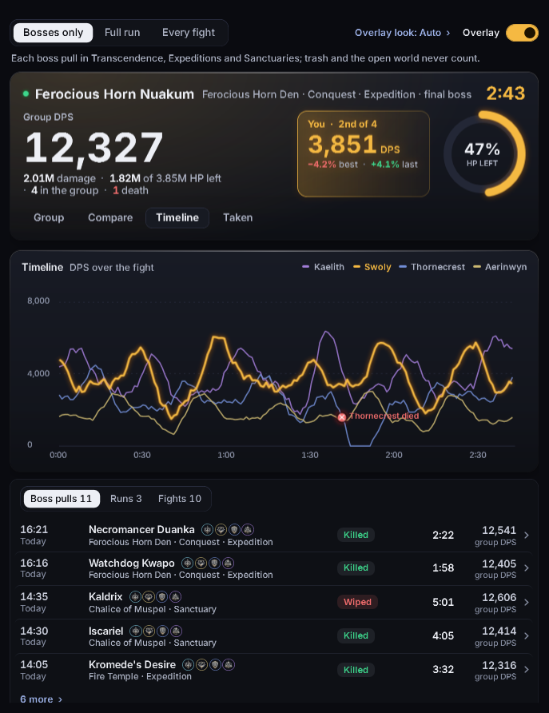 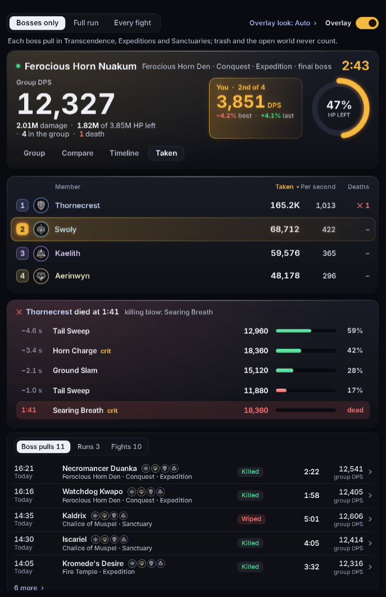 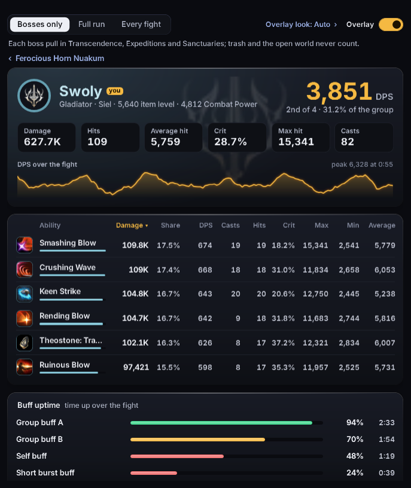
